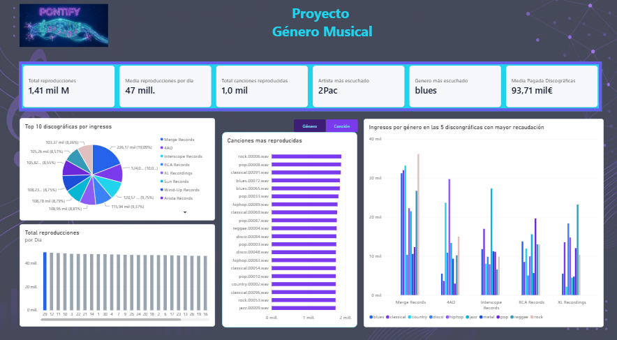
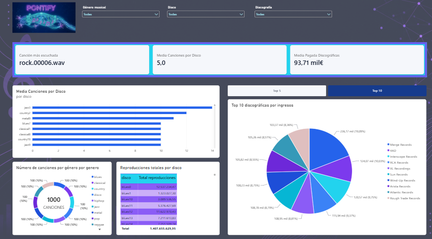
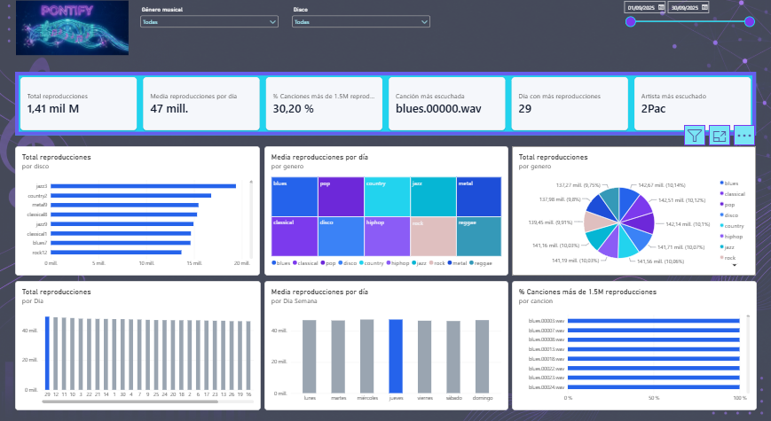
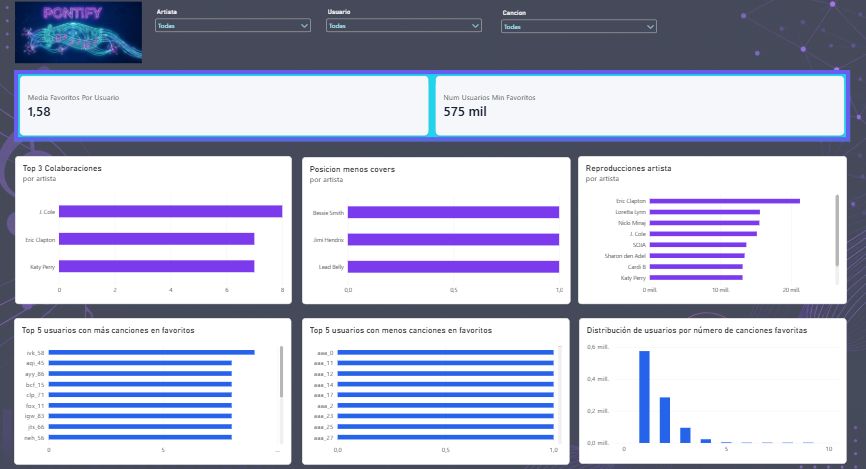
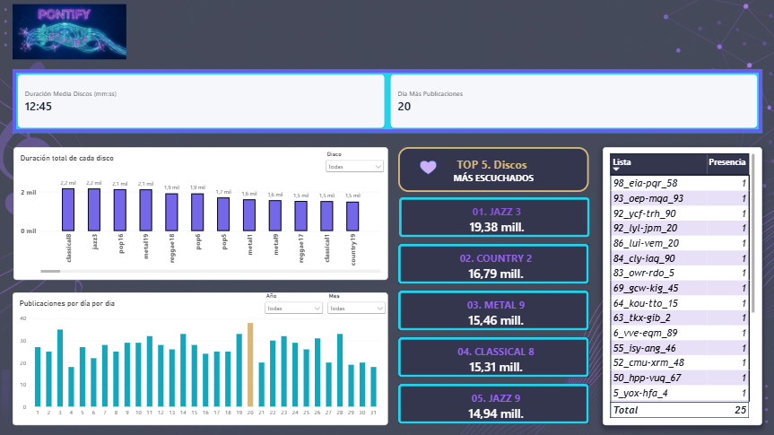

# Proyecto Júpiter: datos, machine learning e IA generativa para una plataforma de música

Proyecto final en equipo del **Máster en Data Analytics & Data Science** (noviembre de 2026).

Solución de datos integral para **Pontify**, una aplicación de música ficticia similar a Spotify: desde el modelo de base de datos y la limpieza de datos hasta un dashboard de KPIs, la clasificación automática del género musical con machine learning y una propuesta de IA generativa.

## El problema de negocio

Pontify basa su propuesta de valor en recomendar música según los géneros favoritos de cada usuario. Para eso necesita que su catálogo de canciones esté bien clasificado, pero:

- La **clasificación de géneros se hace a mano**, algo lento y caro a la escala de su biblioteca.
- Los datos están guardados en **archivos JSON (NoSQL)** sin un procesamiento estructurado, así que la dirección no puede consultar métricas ni detectar incidencias.
- No hay controles de calidad del dato ni seguimiento de KPIs.

## Qué hicimos

El proyecto se organizó en cuatro ejes:

1. **Migración y modelado.** Diseño de un modelo relacional en SQL de 10 tablas, con la canción como tabla central, para que los analistas puedan responder preguntas de negocio.
2. **Calidad del dato.** Análisis exploratorio (EDA) de cada tabla e identificación de errores según reglas de negocio, completitud, duplicidad, formatos, rangos, sesgos y consistencia, con una estrategia de limpieza justificada para cada caso.
3. **Automatización.** Comparación de 9 modelos de machine learning y deep learning para clasificar automáticamente el género musical de cada canción.
4. **Innovación.** Propuesta de IA generativa, *IA Remix en vivo*, que transforma una canción al género que elige el usuario.

Además, se construyó un **dashboard en Power BI** con los KPIs del negocio, contrastados con consultas en MySQL.

## Resultados principales

### Calidad del dato

Se documentaron los errores de cada tabla y la estrategia aplicada en cada caso. Algunos ejemplos:

| Tabla | Hallazgo | Estrategia |
|---|---|---|
| Fecha de publicación | 16,5 % de fechas erróneas (días 0 o 32-36, años imposibles, nulos) | Corregir los días desbordados al mes siguiente y eliminar solo lo que no admite una reconstrucción única. Quedan válidas el 87,8 % |
| Canción | 18 duraciones nulas y 24 canciones por encima del límite de 13 minutos | Rellenar las duraciones desde los archivos de audio y analizar el impacto de la regla por género y autor |
| Coste | 26 costes negativos (2,6 %) | Desplazar la distribución en lugar de eliminar, porque borrarlos quitaba hasta la mitad del catálogo de algunos artistas |
| Favoritos | 1.061 pares usuario-canción duplicados en 1,5 millones de filas | Conservar una fila de cada par |
| Popularidad | Reproducciones negativas y correlación de 0,02 entre el total y la suma diaria | Poner los negativos a 0 y recomendar revisar en origen cómo se recogen las reproducciones |

### Clasificación automática del género

Clasificación supervisada en 10 géneros equilibrados. Para comparar todos los modelos de forma justa, el equipo usó el mismo reparto de entrenamiento y prueba (800 / 200 canciones), separado por canción para que los fragmentos de un mismo tema no aparezcan en los dos conjuntos.

Resultados por canción sobre las 200 canciones de prueba:

| Modelo | Tipo | Entrada | Accuracy | F1 macro | Entrenamiento |
|---|---|---|---|---|---|
| **Random Forest (voto mayoritario)** | ML | Fragmentos de 3 s agregados por canción | **0,81** | **0,81** | 12 s |
| XGBoost | ML | Características de 30 s | 0,78 | 0,77 | 9 s |
| LightGBM (voto mayoritario) | ML | Fragmentos de 3 s agregados por canción | 0,745 | 0,741 | 27 s |
| GRU | DL | Secuencia de fragmentos de 3 s | 0,72 | 0,72 | 12 s |
| KNN | ML | Características de 30 s | 0,705 | 0,70 | < 1 s |
| ANN | DL | Características de 30 s | 0,705 | 0,70 | 16 s |
| RNN simple | DL | Secuencia de fragmentos de 3 s | 0,685 | 0,68 | 12 s |
| Naive Bayes | ML | Características de 30 s | 0,525 | 0,50 | < 1 s |

La LSTM se evaluó por fragmento (accuracy de 0,538 sobre 2.000 fragmentos, con 15 minutos de entrenamiento).

**Modelo elegido: Random Forest con voto mayoritario.** Clasifica cada fragmento de 3 segundos y asigna a la canción el género más votado. Ofrece el mejor rendimiento con un tiempo de entrenamiento bajo y responde a la unidad real del problema, que es la canción completa.

### IA generativa: IA Remix en vivo

A partir de un audio WAV y del género de destino, una llamada a **Gemini 2.5 Flash** genera una nueva versión de la canción que conserva la melodía y la estructura y adapta la instrumentación, el ritmo y la producción al nuevo género. Se probaron ChatGPT, Mureka AI y Gemini con distintos prompts. El mejor resultado lo dio Gemini con un prompt conciso, centrado en conservar la identidad de la canción.

### Dashboard en Power BI

El informe recoge los KPIs del negocio calculados sobre el modelo relacional.

**Resumen ejecutivo**



Visión general del catálogo y del consumo en septiembre de 2025: 1.410 millones de reproducciones totales (unos 47 millones al día), las 1.000 canciones del catálogo reproducidas, el artista y el género más escuchados y la media pagada a las discográficas. Incluye el top 10 de discográficas por ingresos, la evolución diaria de las reproducciones, el ranking de canciones más reproducidas (con selector por género o por canción) y los ingresos por género de las cinco discográficas que más recaudan.

**Catálogo y negocio**



Análisis del catálogo y de los pagos a discográficas, con filtros por género, disco y discográfica: la canción más escuchada, la media de canciones por disco y la media pagada a las discográficas. Muestra los discos con más canciones, el reparto del catálogo por género (100 canciones en cada uno de los 10 géneros), las reproducciones totales por disco y el ranking de discográficas por ingresos, con opción de ver el top 5 o el top 10.

**Popularidad y consumo**



Seguimiento de las reproducciones de septiembre de 2025, con filtros por género, disco y rango de fechas: total y media diaria de reproducciones, porcentaje de canciones con más de 1,5 millones de reproducciones (30,2 %), canción y artista más escuchados y día con más reproducciones. Desglosa las reproducciones por disco, por género, por día del mes y por día de la semana.

**Artistas y usuarios**



Comportamiento de artistas y usuarios, con filtros por artista, usuario y canción: media de favoritos por usuario (1,58) y número de usuarios con el mínimo de favoritos. Incluye los artistas con más colaboraciones, los que menos versiones de otros compositores interpretan, las reproducciones por artista, los usuarios con más y menos canciones en favoritos y la distribución de usuarios según su número de favoritos, que confirma que la mayoría guarda solo una o dos canciones.

**Comunidad musical**



Discos, publicaciones y listas de reproducción: duración media de los discos (12:45) y día del mes con más publicaciones (el 20). Muestra la duración total de cada disco, las publicaciones por día del mes con filtros por año y mes, el top 5 de discos más escuchados y la presencia de las canciones en las listas de los usuarios.

## Estructura del repositorio

```
EDAs/                                  Análisis exploratorio de cada tabla (notebooks, datos raw y procesados)
Modelo de base relacional/             Diagrama del modelo, script SQL y notebook de carga de datos
Métricas y KPIs/                       Consultas SQL de los KPIs del negocio
Dashboard (Power BI)/                  Informe .pbix
Automatización Proyecto Género Musical/  Preprocesado, reparto train/test, modelos y comparativa final
Solución de IA Generativa/             Notebooks y documento de la propuesta IA Remix en vivo
imagenes/                              Capturas del dashboard
```

Cada carpeta funciona de forma independiente: incluye los CSV que necesita para que sus notebooks se puedan ejecutar sin buscar ni mover archivos. Por eso algunos datos aparecen en más de una carpeta. Las carpetas `EDAs` y `Automatización Proyecto Género Musical` tienen su propio README con el orden de ejecución.

## Cómo ejecutarlo

Los notebooks se pueden abrir en Jupyter, Visual Studio Code o Google Colab y localizan sus datos automáticamente. Para el análisis exploratorio:

```bash
pip install -r EDAs/requirements.txt
```

El dashboard requiere Power BI Desktop.

## Herramientas

Python (pandas, NumPy, Matplotlib, Seaborn, Plotly, scikit-learn, XGBoost, LightGBM, Keras), SQL (MySQL), Power BI, Gemini 2.5 Flash (google-genai).

## Equipo

| Integrante | Contribución |
|---|---|
| Alex | EDA de listas y favoritos · KPIs · código de entrenamiento y test y análisis previo de la tabla canción · modelos Random Forest y GRU · redacción de la memoria · KPIs del dashboard |
| Ana Pilar Uceda (autora de este portfolio) | EDA de artistas y features de 30 s · KPIs · modelos LightGBM y RNN simple · comparativa y conclusiones de los algoritmos · código de IA generativa y pruebas de prompt · KPIs del dashboard |
| Gema | EDA de fecha de publicación y canción · KPIs · modelos XGBoost y ANN · código de IA generativa · modelo de datos y KPIs del dashboard |
| Miriam | EDA de popularidad y features de 3 s · comparativa de features de 30 s y 3 s · KPIs · modelos KNN, Naive Bayes y LSTM · presentación del caso de IA generativa · redacción de la memoria · KPIs del dashboard |

## Trabajo futuro

- Pasar de la clasificación a un **motor de recomendación** que combine el género predicho con favoritos, listas y reproducciones de cada usuario.
- Integrar el clasificador en el **alta de canciones nuevas**, con validación humana y reentrenamiento periódico.
- **Corregir los errores en origen**, validando fechas, costes y reproducciones en el momento del registro y trasladando las reglas de negocio a la base de datos.
- Convertir el dashboard en la herramienta habitual de seguimiento, con **actualización automática** y un apartado de incidencias.
- Llevar *IA Remix en vivo* a la aplicación, evaluando antes el coste, la calidad del audio y los derechos de autor.
